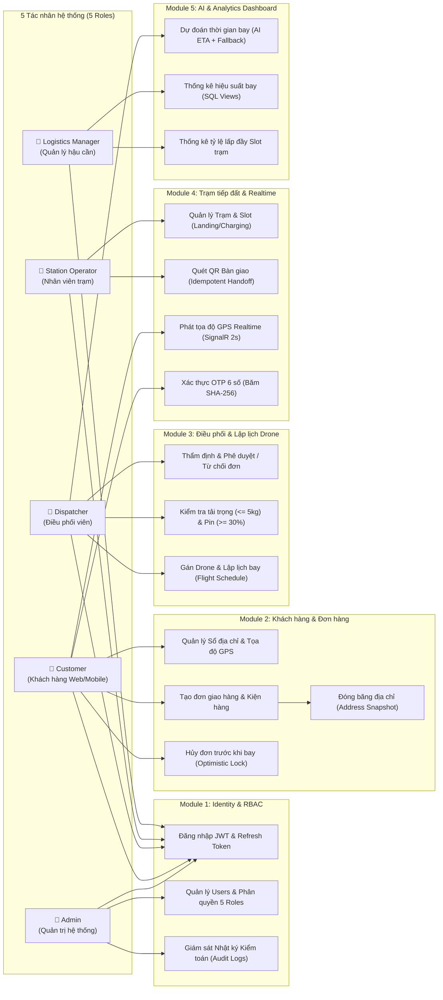
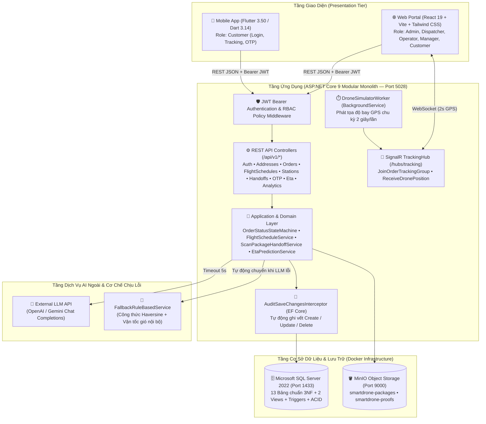
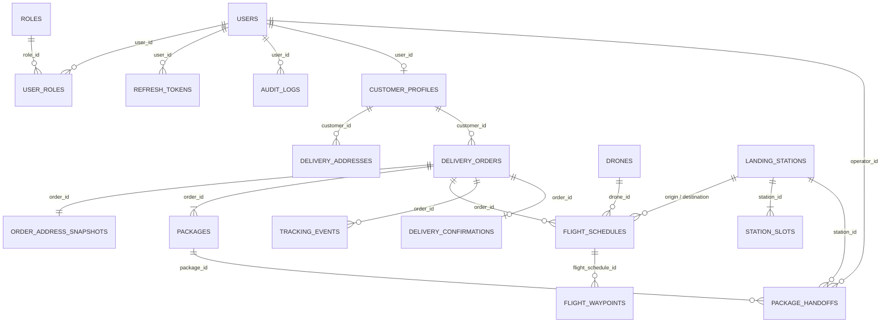
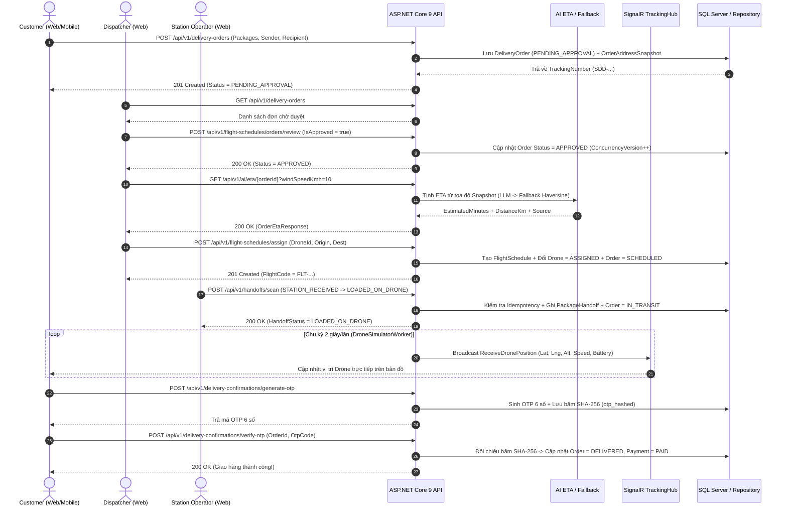
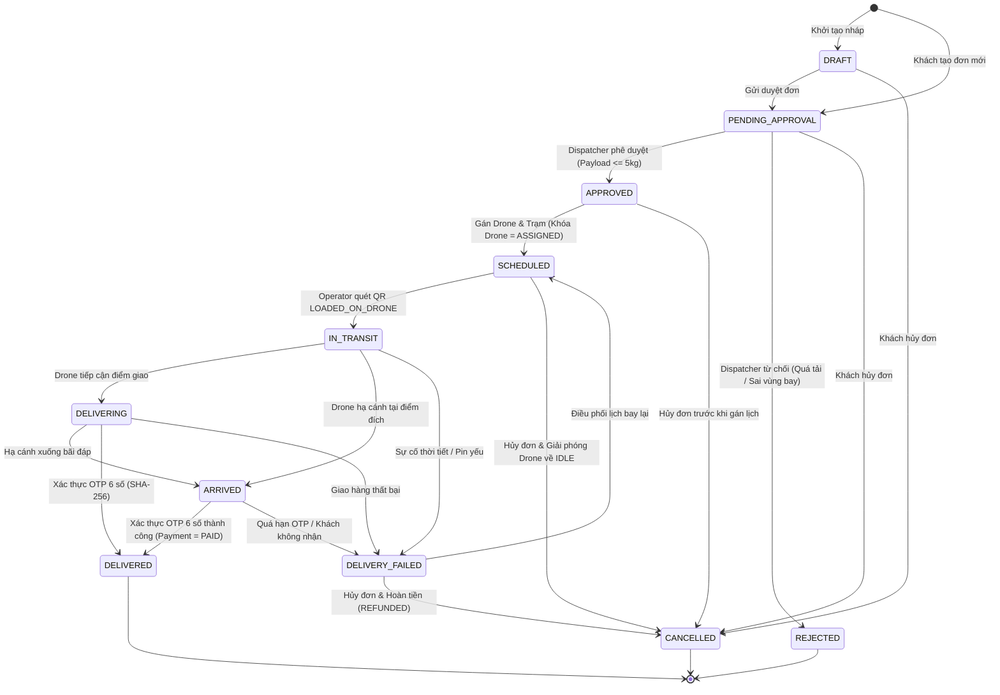

# Bộ 5 Biểu Đồ Thiết Kế Hệ Thống — SmartDroneDelivery

Tài liệu này tổng hợp **5 biểu đồ thiết kế cốt lõi** phục vụ báo cáo và bảo vệ đồ án **Hệ Quản Trị Cơ Sở Dữ Liệu (SmartDroneDelivery)**.

---

## 1. Biểu đồ Phân rã Chức năng & Tác nhân (Use Case / Functional Architecture)

---

## 2. Biểu đồ Kiến trúc Tổng thể Hệ thống (C4 Container & Modular Monolith)

---

## 3. Sơ đồ Thực thể Liên kết — ERD Cơ Sở Dữ Liệu (13 Bảng + 2 Views)

---

## 4. Biểu đồ Tuần tự Luồng Giao hàng Toàn trình (End-to-End Sequence Diagram)

---

## 5. Biểu đồ Máy Trạng thái Vòng đời Đơn hàng (Order Status State Machine)

