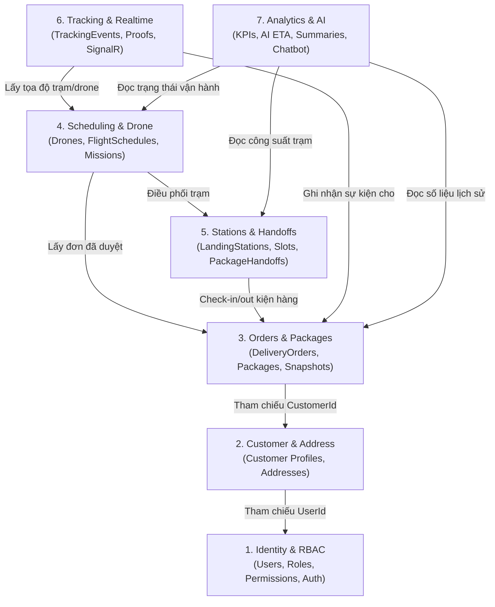

# SmartDroneDelivery — Module Boundaries & Ownership

Tài liệu này xác định ranh giới nghiệp vụ (Bounded Contexts) và phạm vi dữ liệu của từng module trong kiến trúc **Modular Monolith**. Thiết kế này giúp 5 thành viên trong nhóm có thể phát triển song song mà không bị xung đột mã nguồn hay giẫm chân lên nhau.

---

## 1. Bản đồ phân ranh giới Module (Context Map)

---

## 2. Chi tiết từng Module

### Module 1: Identity, Authentication & RBAC (IAM)
- **Trách nhiệm**: Đăng ký, đăng nhập (JWT + Refresh Token), phân quyền 5 roles, quản lý danh sách người dùng nội bộ, cấp quyền truy cập API.
- **Thực thể quản lý**: `User`, `Role`, `UserRole`, `RefreshToken`, `AuditLog`.
- **Nguyên tắc ranh giới**:
  - Không chứa logic nghiệp vụ đặt hàng hay vận chuyển.
  - Cung cấp `ICurrentUserService` để các module khác lấy `UserId`, `Role`, `Email` từ JWT Token của request hiện tại.
- **Thành viên phụ trách**: Thành viên 1 (Lead Backend & Security).

---

### Module 2: Customer & Delivery Address Management
- **Trách nhiệm**: Quản lý hồ sơ khách hàng cá nhân/doanh nghiệp, sổ địa chỉ (Address Book), tọa độ vĩ độ/kinh độ (Latitude/Longitude), gợi ý trạm phục vụ gần nhất theo bán kính.
- **Thực thể quản lý**: `CustomerProfile`, `DeliveryAddress`.
- **Nguyên tắc ranh giới**:
  - Không can thiệp vào tiến trình giao hàng.
  - Khi đơn hàng được tạo, module này cung cấp thông tin để **tạo Snapshot địa chỉ** vào đơn hàng (đảm bảo nếu khách sửa địa chỉ sau này thì đơn cũ không bị thay đổi).
- **Thành viên phụ trách**: Thành viên 2 (Backend & Customer Flow).

---

### Module 3: Delivery Orders & Packages
- **Trách nhiệm**: Quản lý vòng đời đơn hàng (Tạo nháp, gửi duyệt, hủy đơn), thông tin kiện hàng (trọng lượng, kích thước D x R x C, mã vận đơn, loại hàng nguy hiểm, giá trị khai báo, ảnh kiện hàng trên MinIO).
- **Thực thể quản lý**: `DeliveryOrder`, `Package`, `OrderAddressSnapshot`.
- **Nguyên tắc ranh giới**:
  - Sở hữu State Machine của đơn hàng (`OrderStatus`).
  - Giao tiếp với Module 4 qua Interface `ISchedulingService` khi đơn hàng sẵn sàng được lập lịch.
- **Thành viên phụ trách**: Thành viên 2 & Thành viên 3 (Backend Core Logistics).

---

### Module 4: Flight Scheduling & Drone Asset Management
- **Trách nhiệm**: Quản lý danh mục Drone mô phỏng (Model, Tải trọng tối đa, Mức pin, Trạng thái: Rảnh/Đang bay/Bảo trì/Sạc pin), lập kế hoạch chuyến bay (Flight Mission/Schedule), kiểm tra tính khả thi của chuyến bay (trọng lượng hàng ≤ max payload, quãng đường bay ≤ tầm bay của pin).
- **Thực thể quản lý**: `Drone`, `FlightSchedule`, `FlightWaypoint` (tọa độ mô phỏng lộ trình).
- **Nguyên tắc ranh giới**:
  - Chịu trách nhiệm gán Drone và lập lịch xuất phát/hạ cánh.
  - Không trực tiếp xác nhận khách đã nhận hàng.
- **Thành viên phụ trách**: Thành viên 3 (Backend Dispatcher Flow & Simulation).

---

### Module 5: Landing Stations & Package Handoffs
- **Trách nhiệm**: Quản lý các trạm tiếp đất (Landing Station Hubs), số lượng bãi đáp (Landing Pads / Dock Slots), tình trạng hoạt động của trạm; Quản lý biên bản bàn giao kiện hàng (Inbound: người gửi/shipper giao cho trạm; Outbound: trạm gắn hàng lên drone hoặc bàn giao cho khách tại trạm).
- **Thực thể quản lý**: `LandingStation`, `StationSlot`, `PackageHandoff`.
- **Nguyên tắc ranh giới**:
  - Quản lý xác thực việc bàn giao qua mã Barcode/QR Code của kiện hàng.
  - Thay đổi trạng thái bãi đáp (Slot: Available, Occupied, Reserved).
- **Thành viên phụ trách**: Thành viên 4 (Backend Station Flow & Hardware Sim).

---

### Module 6: Tracking, Realtime & Delivery Confirmation
- **Trách nhiệm**: Lưu vết lịch sử thay đổi vị trí và trạng thái (`TrackingEvent`), phát sự kiện thời gian thực qua SignalR Hub (`TrackingHub`), xác nhận giao hàng thành công (Proof of Delivery: ảnh MinIO, OTP bí mật 6 số, chữ ký điện tử).
- **Thực thể quản lý**: `TrackingEvent`, `DeliveryConfirmation`.
- **Nguyên tắc ranh giới**:
  - `TrackingEvent` là bảng Append-Only (chỉ ghi thêm, không bao giờ UPDATE/DELETE để đảm bảo tính pháp lý và lịch sử).
  - Tích hợp SignalR đẩy vị trí drone mô phỏng tới Web/Mobile mỗi 2-3 giây.
- **Thành viên phụ trách**: Thành viên 4 & Thành viên 5 (Realtime & Client Integration).

---

### Module 7: Dashboard, Analytics & AI-Assisted Services
- **Trách nhiệm**:
  - Dashboard thống kê KPI vận hành: Tổng số chuyến bay thành công, thời gian giao trung bình, tỷ lệ sự cố, doanh thu cước phí.
  - **AI Service 1: Smart ETA Predictor** — Dự đoán thời gian giao hàng dựa trên khoảng cách, tốc độ mô phỏng của drone và yếu tố thời tiết/gió.
  - **AI Service 2: Delivery Incident & Executive Summarizer** — Tóm tắt nguyên nhân giao thất bại hoặc sinh báo cáo tóm lược ca trực cho Logistics Manager.
  - **AI Service 3: Customer AI Assistant** — Giải đáp trạng thái đơn, quy định vận chuyển bằng drone thông qua LLM API.
- **Nguyên tắc ranh giới & Fallback**:
  - Phải có interface trừu tượng `IAIService` (gọi OpenAI / Gemini / Claude hoặc mô hình Local).
  - Bắt buộc có `FallbackAIService` (tính toán công thức vật lý vận tốc/quãng đường cố định nếu AI timeout hoặc lỗi mạng).
- **Thành viên phụ trách**: Thành viên 5 (AI Integration & Fullstack Dashboard).

---

## 3. Phân công trách nhiệm 5 thành viên trong 5 tuần

| Thành viên | Vai trò chính | Module phụ trách | Deliverable kỹ thuật |
| :--- | :--- | :--- | :--- |
| **Thành viên 1** (Team Lead) | Backend Lead & Security | Module 1 (IAM), Docker, Infrastructure, Database Script | JWT Auth, RBAC, Nginx, Docker Compose, DB Migrations, Health Checks |
| **Thành viên 2** | Backend & Web Frontend | Module 2 (Customer & Address), Module 3 (Orders & Packages) | API Đơn hàng, Địa chỉ, Quản lý kiện hàng, Màn hình Customer & Orders (ReactJS) |
| **Thành viên 3** | Backend & Web Frontend | Module 4 (Scheduling & Drone Management) | API Điều phối, Gán lịch bay, Quản lý đội Drone, Màn hình Dispatcher Portal (ReactJS) |
| **Thành viên 4** | Backend & Mobile/Realtime | Module 5 (Stations & Handoffs), Module 6 (Tracking & Proof) | Quét QR Handoff, SignalR Tracking Hub, Proof of Delivery (MinIO), Màn hình Station Operator |
| **Thành viên 5** | AI Engineer & Frontend | Module 7 (AI Services, Analytics Dashboard) & Mobile Flutter | Tích hợp AI (ETA, Chatbot, Fallback), Dashboard KPIs (ReactJS), Ứng dụng Mobile Khách hàng (Flutter) |
