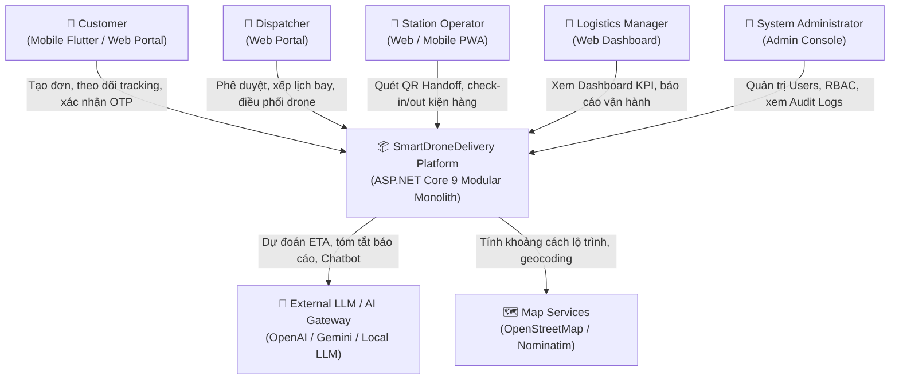
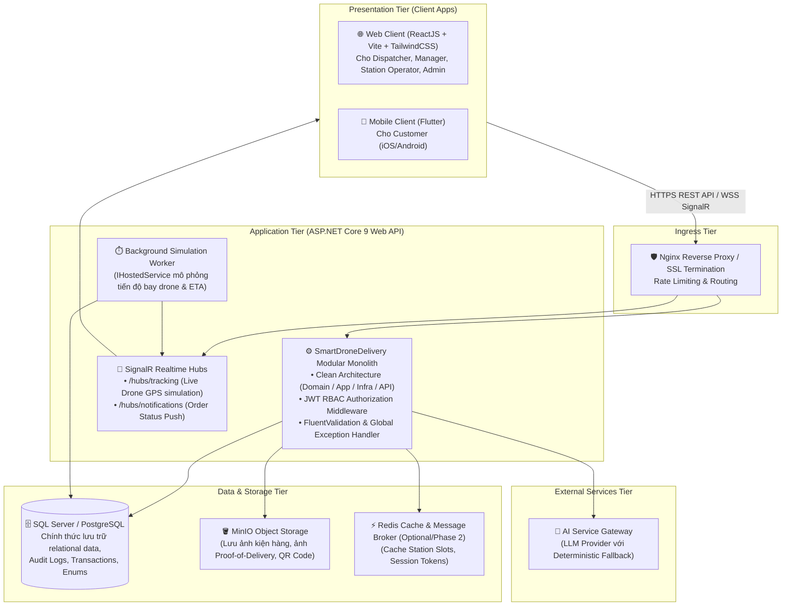

# SmartDroneDelivery — System Overview (C4 Context & Containers)

## 1. Giới thiệu dự án
**SmartDroneDelivery** là Nền tảng Quản lý Quy trình Giao nhận Hàng hóa bằng Drone có tích hợp AI (AI-powered Drone Delivery Management Platform).

> [!IMPORTANT]
> **Phạm vi hệ thống**: Đây là nền tảng **quản lý nghiệp vụ** (Business Process & Logistics Management Platform), **không phải** hệ thống điều khiển bay vật lý (Flight Controller) hoặc autopilot firmware (như ArduPilot/PX4). Các hành vi di chuyển của drone, vị trí GPS và tình trạng pin được mô phỏng theo mô hình toán học và lộ trình định sẵn cho mục đích demo nghiệp vụ thực tế.

---

## 2. Các Actor chính (Hệ thống 5 Vai trò)
1. **Customer (Khách hàng)**: 
   - Tạo yêu cầu giao hàng, quản lý danh bạ địa chỉ nhận/gửi.
   - Theo dõi tiến trình đơn hàng theo thời gian thực (tracking timeline, bản đồ mô phỏng tọa độ drone).
   - Xác nhận nhận hàng qua mã bảo mật (OTP / Dynamic QR Code / Chữ ký số điện tử).
   - Tra cứu và hỏi đáp tự động với AI Chat Assistant.
2. **Dispatcher (Nhân viên Điều phối)**:
   - Thẩm định và phê duyệt đơn hàng (kiểm tra kích thước, trọng lượng, trạm phục vụ).
   - Lập lịch trình giao hàng (Flight Mission/Schedule), chỉ định trạm cất cánh/hạ cánh và gán Drone phù hợp.
   - Theo dõi radar chuyến bay mô phỏng, xử lý sự cố (đổi hướng trạm, hủy chuyến, hoãn do thời tiết).
3. **Station Operator (Nhân viên Vận hành Trạm)**:
   - Quản lý bãi đáp/dock sạc tại trạm tiếp đất (Landing Station Hub).
   - Thực hiện quy trình giao nhận kiện hàng (Inbound/Outbound Package Handoff) bằng cách quét mã vạch/QR.
   - Kiểm tra an toàn tải trọng kiện hàng trước khi gắn vào ngàm drone.
4. **Logistics Manager (Quản lý Hậu cần & Vận hành)**:
   - Giám sát toàn diện hạ tầng: danh sách trạm, đội bay drone, vùng cấm bay mô phỏng (No-fly zones).
   - Xem dashboard phân tích hiệu suất (KPIs: tỷ lệ giao đúng giờ, tỷ lệ hỏng/hủy, năng suất trạm).
   - Sử dụng AI để tổng hợp báo cáo tuần/tháng và tối ưu hóa tuyến đường.
5. **System Administrator (Quản trị viên Hệ thống)**:
   - Quản lý tài khoản, phân quyền Role-Based Access Control (RBAC).
   - Cấu hình tham số hệ thống, giám sát Audit Logs, Health Checks và vận hành hạ tầng Docker.

---

## 3. Kiến trúc C4 — Level 1: System Context Diagram

---

## 4. Kiến trúc C4 — Level 2: Container Diagram

---

## 5. Dòng dữ liệu nghiệp vụ tổng quát (End-to-End Data Flow)

1. **Khách hàng đặt đơn**: Customer nhập thông tin người nhận, địa chỉ hoặc chọn trạm nhận hàng -> Tạo `DeliveryOrder` ở trạng thái `PENDING_APPROVAL`.
2. **Dispatcher kiểm duyệt & lập lịch**:
   - Dispatcher kiểm tra thông số kiện hàng (trọng lượng ≤ tải trọng drone cho phép, kích thước ≤ khoang chứa).
   - Chấp thuận đơn -> Gán `Drone` sẵn sàng và `LandingStation` (Xuất phát & Đích) -> Chuyển sang `SCHEDULED`.
3. **Trạm giao nhận (Handoff)**:
   - Kiện hàng được bàn giao tại Trạm cất cánh -> Station Operator quét mã QR xác nhận `STATION_RECEIVED` qua `PackageHandoff`.
   - Kiện hàng được gắn lên drone -> Chuyển sang `LOADED_ON_DRONE`.
4. **Bay & Theo dõi Realtime (Delivery Mission)**:
   - Hệ thống kích hoạt mô phỏng hành trình bay: `BackgroundService` tính toán tọa độ theo từng giây/chu kỳ từ Trạm A đến Trạm B.
   - `SignalR Hub` phát sự kiện tọa độ (`TrackingEvent`) đến Web và Mobile của khách hàng/điều phối viên.
5. **Hạ cánh & Xác nhận giao hàng (Proof of Delivery)**:
   - Drone hạ cánh tại Trạm nhận / Điểm giao (`ARRIVED_AT_DESTINATION`).
   - Khách hàng cung cấp mã OTP bí mật hoặc quét Dynamic QR Code do hệ thống tạo ra.
   - Operator/Khách chụp ảnh xác nhận kiện hàng nguyên vẹn tải lên MinIO -> Đơn hàng cập nhật `DELIVERED`.

---

## 6. Tiêu chí phi chức năng (Non-Functional Requirements)
- **Tính toàn vẹn dữ liệu (Data Integrity)**: Sử dụng Database Transactions (ACID) cho việc gán lịch bay, trừ slot trạm đỗ và chuyển trạng thái đơn hàng.
- **Tính minh bạch & Lưu vết (Auditability)**: Mọi thao tác đổi trạng thái đơn hàng bắt buộc sinh `TrackingEvent` và ghi nhật ký kiểm toán `AuditLog` kèm User ID, thời gian và địa chỉ IP.
- **Bảo mật**: Mã hóa mật khẩu bằng BCrypt/Argon2id; Phân quyền dựa trên JWT Claims; Kiểm tra quyền nghiêm ngặt tại Controller & Service layer; Không tin cậy Client.
- **Khả năng chịu lỗi của AI**: Mọi tính năng AI (tính ETA, tóm tắt báo cáo, chatbot) đều có Fallback Engine (tính toán dựa trên công thức toán học nội bộ / câu trả lời quy tắc có sẵn) khi API AI ngoài gặp sự cố hoặc timeout (> 3s).
