# SmartDroneDelivery — Entity-Relationship Diagram (ERD)

Tài liệu này định nghĩa mô hình thực thể liên kết (ERD) hoàn chỉnh cho nền tảng SmartDroneDelivery, tuân thủ nguyên tắc chuẩn hóa dữ liệu 3NF, đảm bảo toàn vẹn tham chiếu và tối ưu hóa cho môn học **Hệ Quản Trị Cơ Sở Dữ Liệu**.

---

## 1. Sơ đồ Mermaid ERD Chi tiết

```mermaid
erDiagram
    %% Module 1: IAM & RBAC
    USERS ||--o{ USER_ROLES : has
    ROLES ||--o{ USER_ROLES : assigned_to
    USERS ||--o{ REFRESH_TOKENS : owns
    USERS ||--o{ AUDIT_LOGS : performs
    USERS ||--o| CUSTOMER_PROFILES : has_profile

    %% Module 2: Customers & Addresses
    CUSTOMER_PROFILES ||--o{ DELIVERY_ADDRESSES : manages
    CUSTOMER_PROFILES ||--o{ DELIVERY_ORDERS : places

    %% Module 3: Orders, Packages & Snapshots
    DELIVERY_ORDERS ||--|| ORDER_ADDRESS_SNAPSHOTS : freezes
    DELIVERY_ORDERS ||--|{ PACKAGES : contains
    DELIVERY_ORDERS ||--o{ TRACKING_EVENTS : tracks
    DELIVERY_ORDERS ||--o| DELIVERY_CONFIRMATIONS : confirms
    DELIVERY_ORDERS ||--o{ FLIGHT_SCHEDULES : assigned_in

    %% Module 4: Drone & Scheduling
    DRONES ||--o{ FLIGHT_SCHEDULES : flies
    FLIGHT_SCHEDULES ||--o{ FLIGHT_WAYPOINTS : navigates_through

    %% Module 5: Stations & Handoffs
    LANDING_STATIONS ||--|{ STATION_SLOTS : contains
    LANDING_STATIONS ||--o{ FLIGHT_SCHEDULES : origin_station
    LANDING_STATIONS ||--o{ FLIGHT_SCHEDULES : destination_station
    LANDING_STATIONS ||--o{ PACKAGE_HANDOFFS : handoff_at_station
    PACKAGES ||--o{ PACKAGE_HANDOFFS : transferred_in

    USERS ||--o{ PACKAGE_HANDOFFS : performed_by_operator
    USERS ||--o{ FLIGHT_SCHEDULES : dispatched_by_user

    USERS {
        uuid id PK
        string email UK
        string password_hash
        string full_name
        string phone_number
        string status
        datetime created_at
        datetime updated_at
    }

    ROLES {
        int id PK
        string role_name UK "ADMIN, DISPATCHER, STATION_OPERATOR, LOGISTICS_MANAGER, CUSTOMER"
        string description
    }

    USER_ROLES {
        uuid user_id PK,FK
        int role_id PK,FK
        datetime assigned_at
    }

    REFRESH_TOKENS {
        uuid id PK
        uuid user_id FK
        string token UK
        datetime expires_at
        boolean is_revoked
        datetime created_at
    }

    AUDIT_LOGS {
        uuid id PK
        uuid user_id FK
        string action
        string entity_name
        string entity_id
        string old_values
        string new_values
        string ip_address
        datetime created_at
    }

    CUSTOMER_PROFILES {
        uuid id PK
        uuid user_id FK,UK
        string customer_code UK
        string company_name
        int total_orders
        boolean is_deleted
        datetime created_at
    }

    DELIVERY_ADDRESSES {
        uuid id PK
        uuid customer_id FK
        string address_line
        string ward
        string district
        string city
        decimal latitude
        decimal longitude
        boolean is_default
        boolean is_deleted
        datetime created_at
    }

    LANDING_STATIONS {
        uuid id PK
        string station_code UK
        string name
        string address_line
        decimal latitude
        decimal longitude
        decimal altitude_meter
        int total_slots
        string status "ACTIVE, MAINTENANCE, OFFLINE"
        boolean is_deleted
        datetime created_at
    }

    STATION_SLOTS {
        uuid id PK
        uuid station_id FK
        int slot_number
        string slot_type "LANDING_PAD, CHARGING_DOCK, STORAGE_LOCKER"
        string status "AVAILABLE, OCCUPIED, RESERVED, MAINTENANCE"
        datetime updated_at
    }

    DRONES {
        uuid id PK
        string drone_code UK
        string model
        decimal max_payload_kg
        decimal max_flight_range_km
        decimal max_speed_kmh
        int battery_percentage
        string status "IDLE, ASSIGNED, FLYING, CHARGING, MAINTENANCE"
        boolean is_deleted
        datetime created_at
    }

    DELIVERY_ORDERS {
        uuid id PK
        string tracking_number UK
        uuid customer_id FK
        string status "DRAFT, PENDING_APPROVAL, REJECTED, APPROVED, SCHEDULED, IN_TRANSIT, DELIVERING, ARRIVED, DELIVERED, DELIVERY_FAILED, CANCELLED"
        decimal total_weight_kg
        decimal shipping_fee
        string payment_status "PENDING, PAID, REFUNDED"
        string pickup_method "STATION_DROP, SENDER_ADDRESS"
        string delivery_method "STATION_PICKUP, CUSTOMER_ADDRESS"
        datetime requested_delivery_time
        datetime estimated_delivery_time
        datetime actual_delivery_time
        string cancellation_reason
        int concurrency_version
        datetime created_at
        datetime updated_at
    }

    ORDER_ADDRESS_SNAPSHOTS {
        uuid id PK
        uuid order_id FK,UK
        string sender_name
        string sender_phone
        string sender_address_text
        decimal sender_latitude
        decimal sender_longitude
        string recipient_name
        string recipient_phone
        string recipient_address_text
        decimal recipient_latitude
        decimal recipient_longitude
        datetime created_at
    }

    PACKAGES {
        uuid id PK
        uuid order_id FK
        string package_code UK
        string description
        decimal weight_kg
        decimal length_cm
        decimal width_cm
        decimal height_cm
        decimal declared_value
        boolean is_fragile
        boolean is_hazardous
        string package_photo_url
        datetime created_at
    }

    FLIGHT_SCHEDULES {
        uuid id PK
        string flight_code UK
        uuid order_id FK
        uuid drone_id FK
        uuid origin_station_id FK
        uuid destination_station_id FK
        uuid dispatcher_id FK
        datetime scheduled_departure
        datetime actual_departure
        datetime scheduled_arrival
        datetime actual_arrival
        decimal flight_distance_km
        string status "SCHEDULED, IN_PROGRESS, COMPLETED, ABORTED, REROUTED"
        string abort_reason
        datetime created_at
    }

    FLIGHT_WAYPOINTS {
        uuid id PK
        uuid flight_schedule_id FK
        int sequence_order
        decimal latitude
        decimal longitude
        decimal target_altitude_meter
        decimal estimated_speed_kmh
    }

    PACKAGE_HANDOFFS {
        uuid id PK
        uuid package_id FK
        uuid station_id FK
        uuid operator_id FK
        string handoff_type "INBOUND_CUSTOMER_TO_STATION, OUTBOUND_STATION_TO_DRONE, INBOUND_DRONE_TO_STATION, OUTBOUND_STATION_TO_CUSTOMER"
        string verification_code
        string proof_photo_url
        string notes
        datetime handoff_time
    }

    TRACKING_EVENTS {
        uuid id PK
        uuid order_id FK
        string status_code
        string event_title
        string event_description
        decimal current_latitude
        decimal current_longitude
        decimal current_altitude
        int current_battery
        datetime event_timestamp
    }

    DELIVERY_CONFIRMATIONS {
        uuid id PK
        uuid order_id FK,UK
        string confirmation_method "OTP, DYNAMIC_QR, DIGITAL_SIGNATURE"
        string otp_hashed
        datetime otp_expired_at
        int otp_retry_count
        boolean is_verified
        string recipient_signature_url
        string delivery_photo_url
        datetime confirmed_at
    }
```

---

## 2. Các quy tắc quan hệ & Ràng buộc toàn vẹn (Integrity Rules)

1. **Snapshot địa chỉ (`ORDER_ADDRESS_SNAPSHOTS`)**:
   - Khách hàng có thể thay đổi hoặc xóa địa chỉ trong sổ địa chỉ (`DELIVERY_ADDRESSES`). Do đó, bảng `ORDER_ADDRESS_SNAPSHOTS` lưu bản sao bất biến của địa chỉ người gửi và người nhận tại thời điểm đặt đơn. Khi đơn hàng đã tạo, lịch sử địa chỉ của đơn không bao giờ bị ảnh hưởng.
2. **Nguyên tắc Append-Only (`TRACKING_EVENTS`)**:
   - Bảng này ghi nhận tuần tự thời gian của từng biến cố: tạo đơn, duyệt đơn, lên lịch, cất cánh, tọa độ bay từng chặng, hạ cánh, giao thành công. Chỉ cho phép `INSERT`, không hỗ trợ `UPDATE` hoặc `DELETE`.
3. **Quy tắc Cascade & Restrict**:
   - `USERS -> CUSTOMER_PROFILES`: `ON DELETE RESTRICT` (Không được xóa tài khoản người dùng nếu đã có hồ sơ).
   - `CUSTOMER_PROFILES -> DELIVERY_ORDERS`: `ON DELETE RESTRICT` (Không được xóa khách hàng nếu đã phát sinh đơn hàng).
   - `DELIVERY_ORDERS -> PACKAGES`: `ON DELETE CASCADE` (Xóa đơn nháp thì xóa luôn thông tin kiện hàng đính kèm).
   - `DELIVERY_ORDERS -> ORDER_ADDRESS_SNAPSHOTS`: `ON DELETE CASCADE`.
   - `DRONES -> FLIGHT_SCHEDULES`: `ON DELETE RESTRICT` (Không được xóa drone nếu đã được gán vào chuyến bay trong lịch sử).
   - `LANDING_STATIONS -> FLIGHT_SCHEDULES`: `ON DELETE RESTRICT`.
4. **Optimistic Concurrency Control**:
   - Cột `concurrency_version` kiểu `INT` (hoặc `rowversion` trong SQL Server / `xmin` trong Postgres) tại bảng `DELIVERY_ORDERS` giúp ngăn ngừa tranh chấp khi Dispatcher và Khách hàng cùng thao tác cùng lúc.
